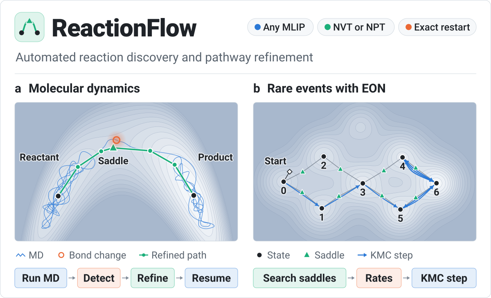

<picture>
  <source media="(prefers-color-scheme: dark)" srcset="docs/figures/overview-dark.svg">
  
</picture>

ReactionFlow finds reactions in molecular dynamics and computes their pathways. It watches the
bonds while a trajectory runs. When a bond forms or breaks and stays that way, the trajectory
pauses at an exact checkpoint, ReactionFlow refines the minimum-energy path of that change with
NEB and climbing-image NEB, and the trajectory continues from the same state. A barrier is
recorded only when the band's highest image is a validated saddle, with one negative-curvature mode
that leads to both ends. The dynamics and the refinement use the same machine-learned
interatomic potential (MLIP), from one of four built-in model families or any ASE calculator.

For reactions too rare to see in MD, ReactionFlow can instead run adaptive kinetic Monte Carlo
with EON, which searches for the saddles out of each state and steps between states by their
harmonic transition-state rates.

## Install

```bash
git clone https://github.com/Austin243/ReactionFlow.git
cd ReactionFlow
python -m pip install .
```

ReactionFlow needs Python 3.12 or newer. The core package depends only on ASE, NumPy, and
NetworkX, and each model backend is installed separately (see [Models](#models)).

## Try it on a laptop

[`examples/xtb`](examples/xtb/README.md) runs 20 ps of malonaldehyde with two water molecules at
500 K, with GFN2-xTB as the potential. It needs no GPU and no model download, and it finishes in a
few minutes on one CPU core.

```bash
python -m pip install . tblite==0.7.0
OMP_NUM_THREADS=1 reactionflow run examples/xtb/campaign.json
reactionflow status examples/xtb/campaign.json
```

Each time a proton moves between oxygens, the run pauses, refines that step, and continues.
`status` then lists the proton transfer as one reaction class, with every occurrence
`saddle_validated` and barriers near 0.15 eV.

## Run your own system

```bash
reactionflow init campaign.json                 # write a campaign by answering questions
reactionflow validate campaign.json             # check it without loading the model
reactionflow prepare campaign.json --install    # install the model's backend, download its weights
reactionflow run campaign.json                  # run the trajectory; rerun the same command to resume
reactionflow status campaign.json               # trajectories, reaction classes, and barriers
```

A campaign is one JSON file with the starting structure, the models, and a list of trajectories
with their temperature, pressure, length, and seed. `init` asks for each of these. Answer "no" when
it asks about GPUs to run on a CPU. A campaign with several trajectories runs one of them with
`run --index N`, or all of them under Slurm with `srun reactionflow run campaign.json`, one task
and one GPU per trajectory. The [campaign guide](docs/campaigns.md) describes the file, and
[pathway refinement](docs/pathway-refinement.md) lists the refinement settings.

Two more commands work on finished output. `reactionflow scan` replays the saved frames through
bond detection, with the run's settings or new ones, and tabulates every bond change and species
([offline scan](docs/offline-scan.md)). `reactionflow check campaign.json band.traj` tests whether
the highest image of any band, from ReactionFlow or another code, is a saddle between its ends.

A number for `pressure_GPa` runs NPT, and the pathway is then refined with variable-cell SSNEB and
gives an enthalpy barrier. `null` runs NVT with ordinary NEB. Each trajectory writes its frames,
every detected occurrence, every refinement with its band and saddle check, and a
`reactions.sqlite3` index under `output_root/<trajectory-id>/`. Nothing is overwritten, and a
resubmitted job continues each unfinished trajectory from its last checkpoint.

## Models

MACE, UMA, AIMNet2, and ANI-1xnr are built in. `reactionflow models` lists their models, heads, and
tasks, and `reactionflow prepare --install` installs the backend a campaign names and downloads
its weights. Some backends pin conflicting versions of e3nn or Torch and need separate
environments ([models guide](docs/models.md)).

Any other model with an ASE calculator runs through the generic adapter, with a profile like this
one. The [models guide](docs/models.md#other-models-through-the-ase-adapter) has tested profiles
for ORB, MatterSim, CHGNet, SevenNet, and NEP89.

```json
"my-model": {
  "factory": "reactionflow.adapters.ase:create_adapter",
  "options": {
    "calculator_factory": "my_package.calculators:MyCalculator",
    "calculator_kwargs": {"model_path": "/abs/path/model.pt", "device": "cuda"},
    "model_files": ["/abs/path/model.pt"],
    "torch_device": "cuda"
  }
}
```

ReactionFlow calls `calculator_factory` with `calculator_kwargs` and records a hash of every file in
`model_files` in each checkpoint. `torch_device` turns on deterministic Torch inference, so that a
restarted trajectory continues exactly; leave it out for a model that does not use Torch.

## Rare events with EON

An EON campaign sets `"mode": "eon"` and takes the same model profiles. EON runs on Linux x86_64.
This example uses an analytic two-atom potential and runs in seconds.

```bash
python -m pip install '.[eon]'
PYTHONPATH=examples/eon reactionflow run examples/eon/campaign.json
reactionflow status examples/eon/campaign.json
```

With `"guide": {"form": ["C-N"], "break": ["C-H"]}`, each search pushes one pair of the named
element types together or apart instead of moving atoms at random, and pairs can also be named by
atom ID. See the [EON guide](docs/eon-search.md).

## How it works

[How ReactionFlow works](docs/how-it-works.md) walks through bond detection, pathway refinement
and its outcomes, reaction classes, EON searches and kinetic Monte Carlo, constant pressure, exact
restart, and running on a cluster, with figures made from ReactionFlow's own output.

## Limits

A detected change only means that two atoms crossed a distance threshold. ReactionFlow does not
assign bond orders, compute free energies, or run an IRC, and MD mode gives no rates. The saddle
check's Hessian holds the atoms that do not move through the saddle and the cell fixed, so one mode
that connects both ends is strong evidence for a saddle but does not prove one. The thresholds and
observation interval need checking for each system.

EON rates come from harmonic transition-state theory, which suits barriers well above kT in stiff
solids and on surfaces. Without `basins`, states joined by a very low barrier are not merged, so
such a pair makes every step short; `basins: "bonds"` merges them when no bond changes. In
liquids the softest modes are collective solvent motions that lead to no saddle, searches rarely
connect, and MD mode is the better choice.

## Documentation

- [How ReactionFlow works](docs/how-it-works.md)
- [Campaigns](docs/campaigns.md), with the file format, several models in one campaign, Slurm, and
  status
- [Models](docs/models.md), with every backend, its options, and its environment
- [EON mode](docs/eon-search.md)
- [Bond detection](docs/bond-detection.md)
- [Candidate tracking](docs/candidate-tracking.md)
- [Offline scan](docs/offline-scan.md)
- [Reaction identity](docs/reaction-identity.md)
- [Occurrence store](docs/occurrence-store.md)
- [Pathway refinement](docs/pathway-refinement.md)
- [Exact restart](docs/exact-restart.md)

## License

BSD 3-Clause. See [LICENSE](LICENSE) and [NOTICE](NOTICE).
